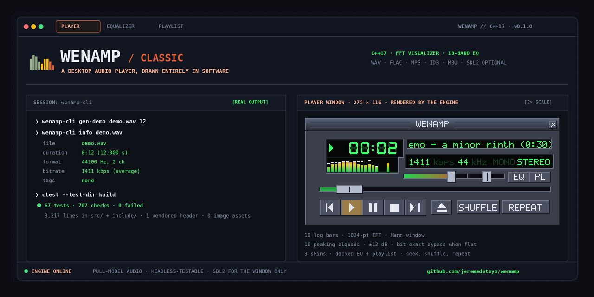

```
                                                                              
   WENAMP / CLASSIC                                                           
                                                                              
  ### A desktop audio player, drawn entirely in software.                     
                                                                              
  C++17 · 19-bar FFT visualizer · 10-band equalizer · docked three-window skin
  Pull-model audio engine · procedural skin · zero image assets               
                                                                              
```

[](https://github.com/jeremedotxyz/wenamp/actions/workflows/checks.yml)
[](https://isocpp.org/)
[](https://github.com/jeremedotxyz/wenamp)
[](docs/architecture.md#1-dependency-policy)
[](docs/classic-layout.md)
[](https://github.com/jeremedotxyz/wenamp/actions)

[Start here](#-quickstart) · [Architecture](docs/architecture.md) · [Classic layout](docs/classic-layout.md) · [Operator guide](docs/operator-guide.md)



**Wenamp** is a classic desktop audio player rebuilt from scratch in C++17. It has the familiar arrangement: a title bar, a recessed LCD readout with seven-segment time, a live spectrum, a seek bar, a row of transport buttons, and docked **equalizer** and **playlist** windows. Every pixel is drawn in software from rectangles, a 5×7 bitmap font and seven-segment geometry.

The design rule that makes it small and testable: **the engine never knows about a window.** Audio is *pulled* through one function, the UI is a pure function of state painted into a pixel buffer, and input arrives as plain coordinates. The SDL window, the headless CLI and the unit tests all drive exactly the same code, so the whole player can be exercised, rendered to an image and regression-tested without a screen or a sound card.

> Wenamp reproduces the *arrangement* of the classic 275-pixel-wide player. It uses no original skin art, bitmaps, fonts or code, and is not affiliated with or endorsed by the makers of any existing player.

---

## 🧭 Capabilities

| Subsystem | Role | Working Capability | Telemetry & Artifacts |
| :--- | :--- | :--- | :--- |
| **Player Engine** | Decode → EQ → mix → output | WAV / FLAC / MP3, 44.1 kHz float pipeline, seek, volume, balance | End-of-track signal, position, source rate / channels / bitrate |
| **Spectrum Analyzer** | 1024-pt Hann FFT, 19 log bars | Instant attack, smooth decay, falling peak caps, 50 Hz – 16 kHz | Per-bar levels, bin-range table |
| **Equalizer** | Preamp + 10 peaking biquads | ±12 dB per band, 8 presets, bit-exact bypass when flat | True combined response curve drawn live |
| **Playlist** | Order, shuffle, repeat | Shuffle with history, repeat off / all / one, M3U read & write | Reproducible shuffle seeds, running total time |
| **Tag Reader** | ID3v2.3 / v2.4 and ID3v1 | Latin-1, UTF-16, UTF-8 → `Artist - Title` | Safe against malformed frames |
| **Skin Renderer** | Software canvas, 3 themes | Bevels, LCD digits, sliders, marquee, docked windows | Deterministic frames, PPM export, frame hashes |
| **Front-ends** | `wenamp` (SDL2) · `wenamp-cli` | Draggable window, file drop, shortcuts · info / analyze / render-ui / bench | Headless screenshots, selftest, throughput numbers |

---

## 🚀 Quickstart

Wenamp needs a **C++17 compiler and CMake ≥ 3.16**. The audio library ([miniaudio](https://miniaud.io)) is vendored in `third_party/`; SDL2 is optional and only provides the window.

```bash
# Clone the repository
git clone https://github.com/jeremedotxyz/wenamp.git
cd wenamp

# Build (SDL2 is detected automatically)
cmake -S . -B build
cmake --build build -j

# Generate something to listen to, then open the player
./build/wenamp-cli gen-demo demo.wav 30
./build/wenamp demo.wav --eq --playlist
```

No SDL2 installed? `wenamp-cli` and the tests still build; the window front-end is skipped with a clear message.

### Direct Commands

```bash
# Inspect a file: format, duration, bitrate, ID3 tags
./build/wenamp-cli info song.mp3

# Watch the 19-bar spectrum scroll past as ASCII
./build/wenamp-cli analyze song.mp3 --seconds 4

# Render the real UI (mid-song, equalizer + playlist open) to an image
./build/wenamp-cli render-ui shot.ppm --demo --at 2.2 --eq --playlist --preset Rock --scale 3

# Measure EQ, FFT and UI-render throughput on your machine
./build/wenamp-cli bench

# Run the test suite
ctest --test-dir build --output-on-failure
```

### Controls

| Input | Action | | Input | Action |
| :--- | :--- | :--- | :--- | :--- |
| `Z` `X` `C` `V` `B` | Prev · Play · Pause · Stop · Next | | `S` / `R` | Shuffle / Repeat (Off → All → One) |
| `Space` | Toggle pause | | `E` / `P` | Equalizer / Playlist window |
| `←` `→` | Seek ∓5 s | | `T` | Next theme |
| `↑` `↓` | Volume ±5 % | | Drop a file | Add (and play if idle); `.m3u` expands |

Full mouse and keyboard reference: [classic-layout.md](docs/classic-layout.md#keyboard--mouse).

---

## 🔬 How It Fits Together

```
   mouse / keys / drop ──► Ui ◄────► Playlist (order · shuffle · repeat · M3U · ID3 titles)
                            │
              ┌─────────────┴──────────────┐
              ▼                            ▼
   Player.render(frames)             Ui.render(canvas) ──► SDL texture  (or PPM in the CLI)
   decode → EQ → volume/balance            ▲
              │                            │ bars
              └── 1024 mono samples ──► SpectrumAnalyzer
```

The window, the CLI and the tests all call the same `Player::render()` and `Ui::render()`. Details, the threading model, the DSP math and the bar-to-frequency table are in [docs/architecture.md](docs/architecture.md).

---

## 🏛 Project Structure

```
wenamp/
  ├── .github/workflows/
  │     └── checks.yml                # CI: GCC + Clang build, ctest, CLI checks, headless SDL smoke test
  ├── docs/
  │     ├── assets/
  │     │     ├── social-preview.png  # 1280x640 share card generated from the real engine
  │     │     └── social-preview.svg  # Vector source (player frame embedded)
  │     ├── architecture.md           # Signal path, threading, DSP math, testing strategy
  │     ├── classic-layout.md         # Pixel-exact control rectangles, themes, shortcuts
  │     └── operator-guide.md         # Build options, command & flag reference, presets, troubleshooting
  ├── include/wenamp/
  │     ├── canvas.hpp  font.hpp      # Software framebuffer + 5x7 bitmap font
  │     ├── eq.hpp  fft.hpp           # 10-band equalizer, radix-2 FFT
  │     ├── player.hpp  playlist.hpp  # Audio engine, playlist logic
  │     ├── spectrum.hpp  tags.hpp    # 19-bar analyzer, ID3 reader
  │     ├── theme.hpp  ui.hpp         # Skins, window controller & renderer
  │     └── version.hpp  wav.hpp      # Version + engine format, WAV writer / test-signal generators
  ├── scripts/
  │     └── generate_social_preview.py # Preview artwork built from real engine output
  ├── src/
  │     ├── player.cpp  eq.cpp  fft.cpp  spectrum.cpp  playlist.cpp  tags.cpp  wav.cpp
  │     ├── canvas.cpp  font.cpp  theme.cpp  ui.cpp
  │     ├── cli_main.cpp              # wenamp-cli
  │     ├── platform_sdl.cpp          # wenamp (SDL2 window front-end)
  │     └── miniaudio_impl.cpp        # Compiles the vendored miniaudio
  ├── tests/
  │     ├── testing.hpp  test_main.cpp # Tiny dependency-free test harness
  │     ├── test_dsp.cpp              # FFT vs. naive DFT, analyzer, EQ accuracy & bypass
  │     ├── test_playlist.cpp         # Navigation, shuffle coverage, repeat, M3U round-trip
  │     ├── test_tags.cpp             # ID3v1 / ID3v2 encodings and bad input
  │     ├── test_player.cpp           # Render, seek, pause, end signal, volume, balance, resample
  │     └── test_ui.cpp               # Every hit region, drags, keys, auto-advance, deterministic frames
  ├── third_party/
  │     └── miniaudio.h               # v0.11.22 (public domain / MIT-0)
  └── CMakeLists.txt
```

---

## 🔬 Scope and Bounds

- **Formats**: WAV, FLAC and MP3 (miniaudio's built-in decoders). OGG Vorbis, AAC and Opus are not supported.
- **Tags**: ID3 only (v1, v2.3, v2.4). Other tag systems fall back to the file name.
- **Fixed engine format**: everything is resampled to 44.1 kHz stereo float. There is no gapless playback or crossfade.
- **Visualizer resolution**: a 1024-point FFT has 43 Hz bins, so the lowest few bars share bins. This is documented in [architecture.md](docs/architecture.md#spectrum-analyzer-wenampspectrumanalyzer).
- **Window model**: the equalizer and playlist are *docked* in one column (they slide up when hidden), not free-floating windows. Skins are procedural themes; loading third-party skin files is not supported.
- **Display text**: the built-in 5×7 font covers printable ASCII; other characters render as `?`.
- **No file-open dialog**: add files by command line or drag-and-drop.
- **Headless-safe**: with no sound card, miniaudio's null backend keeps the engine running, and `wenamp` warns and continues silently if no device opens. The test suite needs neither audio hardware nor media files.
- **Platforms**: developed and tested on Linux (GCC 13 and Clang 18). The code uses only portable C++17, miniaudio and SDL2, so macOS and Windows should work, but they are not yet verified in CI.

---

## 🎨 Artwork and Licensing

The 1280 × 640 share card (`docs/assets/social-preview.png`) is generated from the project itself: the player window is rendered by the real engine (`wenamp-cli render-ui`), the terminal panel is the real output of `wenamp-cli info`, and the test and line counts are read from the repository (the script refuses to print a green test count if the suite is failing). Its editable vector source (`docs/assets/social-preview.svg`) is included. Regenerate with Python + Pillow after building:

```bash
pip install Pillow
python scripts/generate_social_preview.py
```

[miniaudio](https://github.com/mackron/miniaudio) is vendored under its public-domain / MIT-0 terms. This repository has no license grant selected by its owner for the rest of the code. Public visibility does not itself grant an open-source license.

---

*Every pixel is a choice. Pull the audio, draw the frame, keep the window thin.*
